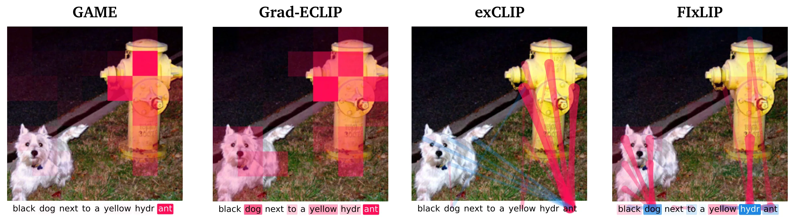

FIxLIP: Explaining Similarity in Vision-Language Encoders
=========================================================

.. rst-class:: shapiq-examples-lead

FIxLIP provides faithful interaction explanations of language–image pre-training models
:cite:p:`Baniecki.2025`. It explains the similarity that encoders such as CLIP and SigLIP 2 predict
for an image–text pair. This demo lets you explore FIxLIP explanations for five image–text pairs
from MS COCO. All explanations are computed with ``shapiq``.

.. shapiq-demo:: fixlip
   :fallback: images/hero_siglip2.png
   :alt: A photo of a giraffe drinking at a river and the text 'a giraffe drinking water from a river', explained by a network of image regions and words, linked by the interactions that raise (red) or lower (blue) the similarity that SigLIP 2 assigns them.

The rest of this page explains the demo step by step. We first motivate the problem, describe the
encoders, and argue why their similarity predictions can only be explained with interactions. We
then review related work and introduce the FIxLIP game, the explanation, and the views of the demo.
Finally, we describe how FIxLIP is computed and evaluated, compare the two models, and show how to
compute it with ``shapiq``.

**The figures follow the demo.** They show the image–text pair that is chosen in the demo, and
each figure has its own selector to change the pair for the whole page. Below each figure, a short
note reads off its numbers for the chosen pair. Where a figure reports predictions of a model,
these are predictions of SigLIP 2. The figures with results of the paper do not change with the
pair.

Why explain similarity?
-----------------------

Contrastive language–image pre-training (CLIP) :cite:p:`Radford.2021` revolutionized computer
vision by learning data representations that perform well in many downstream tasks. Scaling the
training to predict similarity between image and text, combined with continuous architectural
improvements such as SigLIP :cite:p:`Zhai.2023` and SigLIP 2 :cite:p:`Tschannen.2025` and
increasing the size of datasets, leads to the development of powerful *vision–language encoders*.
These rather opaque encoders become the backbone components in large vision–language models capable
of actual conversation and reasoning. They are increasingly applied in high-stakes decision-making,
like in the case of medical imaging :cite:p:`Zhao.2025`.

One way of validating similarity predictions at inference time is explaining the encoders with
*saliency maps* :cite:p:`Chefer.2021,Zhao.2024`. However, these first-order importance scores are
limited by their unimodal view of the model's output. **Vision–language encoders cannot be
faithfully explained without taking into account the cross-modal interactions between image–text
pairs** :cite:p:`Liang.2023`.

FIxLIP :cite:p:`Baniecki.2025` addresses this limitation from a game-theoretic perspective. Input
tokens, i.e. image patches and text tokens, form coalitions of players in a *cooperative game*. The
resulting explanation assigns *attribution scores* to each token and *interaction scores* to each
pair of tokens in an image–text pair. It thus shows **which words go with which parts of an
image**.

Vision–language encoders in a nutshell
--------------------------------------

A vision–language encoder :math:`f` consists of two encoders. The *vision encoder* :math:`f_I`
splits an image :math:`x_I` into patches and maps them to one embedding vector. The *language
encoder* :math:`f_T` splits a text :math:`x_T` into tokens and maps them to an embedding vector of
the same dimension. The model then predicts how well the image and the text match as the *cosine
similarity* of the two embeddings.

.. math::

   f(x_I, x_T) = \cos\big(f_I(x_I), f_T(x_T)\big)
   = \frac{f_I(x_I) \cdot f_T(x_T)}{\lVert f_I(x_I) \rVert \, \lVert f_T(x_T) \rVert}

CLIP learns the two encoders jointly from image–text pairs with a contrastive loss, which pulls
matching pairs together and pushes all other pairs of a batch apart. SigLIP replaces the softmax
over the batch with a sigmoid loss on every pair, and SigLIP 2 extends its training recipe. The
demo uses the ViT-B/32 variant of both models. CLIP splits an image of 224 × 224 pixels into 7 × 7
patches, whereas SigLIP 2 splits an image of 256 × 256 pixels into 8 × 8 patches.

.. shapiq-demo-figure:: fixlip encoders
   :alt: A photo, cut into 8 by 8 patches, goes through the vision encoder. Its text, cut into tokens, goes through the language encoder. The cosine similarity of the two embeddings is the prediction of the model.

   **From an image–text pair to a similarity.** SigLIP 2 encodes the patches of the image and the
   tokens of the text separately. The two embeddings meet only in the cosine similarity.

The two models predict very different numbers for the same pair. These numbers cannot be compared
directly, because every model has its own scale. The demo therefore relates each prediction to 200
images from MS COCO :cite:p:`Lin.2014`. Each image is paired with its own caption, which gives 200
matching pairs, and with the captions of all other images, which gives 39,800 unrelated pairs. All
five pairs of the demo score at least as high as a typical matching pair for both models. Thus,
both models find that each text describes its image well.

.. shapiq-demo-figure:: fixlip scale
   :alt: For SigLIP 2, matching pairs have similarities around 0.15 and unrelated pairs around minus 0.03. For CLIP, matching pairs are around 0.31 and unrelated pairs around 0.15. The chosen pair lies in the upper part of the matching pairs for both models.

   **Every model has its own scale.** Thick bars cover the middle half of the pairs and thin lines
   cover the middle 90%. Gaps mark the medians and dots mark the chosen pair.

The demo shows this prediction as *No explanation*. A single number tells how similar the model
finds the pair, but not why.

Why interactions are the natural language of similarity
-------------------------------------------------------

Explanations of a classifier usually attribute a score to the parts of one input. A similarity
prediction is different, because it is a property of an image–text pair. The following three
observations show why its explanation has to include interactions.

**Neither modality has a similarity on its own.** The dot product in the equation above multiplies
the coordinates of the image embedding with those of the text embedding. Thus, what an image patch
contributes to the prediction depends on the text it is compared with, and vice versa. The figure
below illustrates this. With the image alone or the text alone, the prediction of SigLIP 2 stays
close to its prediction for an empty input, in which all patches and all text tokens are masked.
Often it is even lower. Only both modalities together reach the similarity of the pair.

.. shapiq-demo-figure:: fixlip modalities
   :alt: Four masked versions of the pair with the similarity that SigLIP 2 predicts. With no tokens, with the image only and with the text only, the similarity is low. With all tokens, it is high.

   **Similarity needs both modalities.** The prediction of SigLIP 2 when a modality is masked.
   Gray patches and crossed-out text tokens are masked.

**A similarity without cross-modal interactions would be useless.** Assume that the prediction were
the sum of one score for the image and one score for the text. The best text would then be the same
for every image, and the best image the same for every text. Retrieval and zero-shot classification
work only because the prediction is more than such a sum. Thus, what makes a vision–language
encoder useful is contained in its cross-modal interactions, of which FIxLIP explains the pairwise
part.

**Saliency maps cannot say which words go with which parts of an image.** A first-order attribution
assigns one score to each token. It can highlight an object in the image and the words of the text.
However, it cannot tell which of the words the model matched with the object. The figure below
answers this with the model itself. For two objects of the image, it shows the prediction for the
region of one object and the words that name one of them, with everything else masked. For the
first pair of the demo, the region of the elephant goes with *elephant* and the region of the egret
goes with *white bird*, while swapping the words lowers the similarity in both rows. Four of the
five pairs show this pattern in both rows. Only an interaction between an image patch and a text
token can express such a relation.

.. shapiq-demo-figure:: fixlip regions
   :alt: A matrix of four similarities. Its rows are two regions of the image, each showing one object. Its columns are the words that name the two objects. The similarity is highest where a region meets the words that name its object.

   **Which words go with which regions.** The prediction of SigLIP 2 for one region of the image
   and one part of the text, with everything else masked. The regions were chosen by hand.

This argument is not specific to CLIP, since any model that scores an image–text pair has to relate
tokens across the two modalities. It also agrees with the user studies of :cite:t:`Liang.2023`, in
which visualizing second-order attributions was necessary for understanding multimodal models.

Related work and its shortcomings
---------------------------------

Most explanation methods for vision–language encoders compute first-order attributions and
visualize them as saliency maps. This includes *gradient-based* methods such as Grad-ECLIP
:cite:p:`Zhao.2024`, *attention-based* methods such as GAME :cite:p:`Chefer.2021`, and
*information-based* methods :cite:p:`Wang.2023b,Zhu.2025`. Shapley and Banzhaf values offer a
game-theoretic alternative. For example, MM-SHAP :cite:p:`Parcalabescu.2023` uses Shapley values to
measure how much each modality contributes. All of these methods assign one score per token. Thus,
they cannot disentangle which words relate to which image regions.

A second line of work approximates second-order attributions. :cite:t:`Joukovsky.2023` approximate
the interactions with bilinear models, which :cite:t:`Sammani.2024` apply to image–image encoders.
In concurrent work to FIxLIP, exCLIP :cite:p:`Moeller.2025` approximates only the cross-modal
interactions, based on Integrated Hessians :cite:p:`Janizek.2021`. It omits the *main effects* of
single tokens and the *intra-modal* interactions, e.g. between two words. Its explanation is thus a
bipartite graph without weights on its nodes. In the experiments of the paper, exCLIP fails to
recover the subsets of tokens that matter most for the prediction, which the authors attribute to
these missing terms.

 FIxLIP shows both.
   :width: 100%
   :figclass: fixlip-paper-figure

   **The methods on one input.** Explanations of CLIP (ViT-B/32) by two first-order methods, by
   exCLIP, and by FIxLIP. Reproduced from Figure 2 of the paper :cite:p:`Baniecki.2025`.

.. list-table:: Families of explanation methods for vision–language encoders.
   :header-rows: 1
   :widths: 30 26 44

   * - Approach
     - Explanation
     - Shortcoming
   * - Gradient-based, attention-based, and information-based methods
       :cite:p:`Zhao.2024,Chefer.2021,Wang.2023b`
     - One score per token
     - Unimodal view without a relation between words and regions. They need access to the
       internals of the model.
   * - Shapley and Banzhaf values
     - One score per token
     - Model-agnostic, but still without a relation between words and regions.
   * - Cross-modal interactions, e.g. exCLIP :cite:p:`Moeller.2025`
     - One score per pair of an image patch and a text token
     - No main effects and no intra-modal interactions. exCLIP needs gradients of both encoders.
   * - FIxLIP :cite:p:`Baniecki.2025`
     - One score per token and per pair of tokens
     - Many model evaluations, and restricted to the second order.

FIxLIP formalizes the problem with game theory. Its explanation covers main effects, cross-modal
interactions, and intra-modal interactions. Moreover, it is model-agnostic, since it only needs the
predictions for masked inputs. The figure below illustrates what each family of explanations can
express for the chosen pair. Note that all three panels show the same FIxLIP explanation and not
the output of the other methods.

.. shapiq-demo-figure:: fixlip related
   :alt: Three panels with the photo and its tokens. Left, tokens and patches are tinted by one score each. In the middle, lines link patches and words. Right, tints and lines between all kinds of tokens.

   **Three views of one explanation.** The FIxLIP explanation of the pair converted to first-order
   attributions, restricted to cross-modal interactions, and shown with its main effects and
   strongest interactions. **Red** raises the similarity and **blue** lowers it. Image patches and
   text tokens are tinted on separate scales.

The FIxLIP game
---------------

FIxLIP views the input tokens as players of a cooperative game. Let :math:`N_I` and :math:`N_T`
denote the sets of image patches and text tokens. For SigLIP 2 and the pairs of the demo, these are
64 image patches and 10 to 19 text tokens, e.g. :math:`n = 74` players for the first pair. A *mask*
:math:`M \subseteq N_I \cup N_T` selects the tokens that the model receives. The *game* assigns to
each mask the similarity that the model predicts for the masked image–text pair.

.. math::

   \nu(M) = f\big(x_I \oplus_{M \cap N_I} b_I, \; x_T \oplus_{M \cap N_T} b_T\big)

Here, :math:`\oplus` keeps the tokens in :math:`M` and replaces all others with a baseline
:math:`b_I` or :math:`b_T`. For the image, a masked patch is set to 0 after normalization, which
propagates no signal forward. The figures show it as a gray patch. For the text, a masked token is
excluded through the attention mask of the encoder, while special tokens and padding are always
kept.

.. shapiq-demo-figure:: fixlip game
   :alt: Five masked versions of the pair with the similarity that SigLIP 2 predicts. All tokens, no tokens, the image without one object, the image without another object, and a random mask.

   **The game assigns a similarity to every mask.** Five of the :math:`2^n` masks of the pair with
   the predictions of SigLIP 2. Gray patches and crossed-out text tokens are masked.

For example, removing an object from the image lowers the similarity for all five pairs, although
the text still names the object. With :math:`2^n` masks, the game cannot be inspected directly.
Thus, an explanation has to summarize it.

Note that the paper explains the logit-scaled similarity :math:`C \cdot f(x_I, x_T)`, where the
learnt constant :math:`C` is about 100 for CLIP and about 112 for SigLIP 2. The demo explains the
cosine similarity itself, so its values are smaller by this factor.

The FIxLIP explanation
----------------------

A FIxLIP explanation :math:`e` assigns a constant :math:`e_0`, a *main effect* :math:`e_i` to each
token, and an *interaction* :math:`e_{ij}` to each pair of tokens. Together, they approximate the
game with a simple additive model.

.. math::

   \hat{\nu}_e(M) = e_0 + \sum_{i \in M} e_i + \sum_{\{i,j\} \subseteq M} e_{ij}

An interaction is *cross-modal* if it links an image patch with a text token. It is *intra-modal*
if it links two image patches or two text tokens. The explanation can be viewed as a complete graph
with the tokens as weighted nodes and the interactions as weighted edges. The demo calls the image
patches *regions* and the text tokens *words*.

**What an interaction measures.** A positive interaction means that two tokens raise the similarity
more together than the sum of their individual effects. The figure below measures this directly on
the model, for the strongest interaction of the explanation between an image patch and a word. We
sample 256 random masks of all other tokens, in which each token is kept with probability 0.5, and
add the patch, the word, or both. What both add beyond the sum of their individual effects is their
interaction. The second panel pairs the same patch with the word that has the largest main effect.
Here, both together add just about the sum of their individual effects, so their interaction is
close to zero. For all five pairs, the interaction measured on the model agrees with the estimate
of the explanation up to 0.002.

.. shapiq-demo-figure:: fixlip interaction
   :alt: Two bar charts. Each shows how much a patch alone, a word alone and both together change the similarity on average, and the interaction, which is what both add beyond the sum of the two. The interaction is large in the first chart and close to zero in the second.

   **An interaction measured on the model.** The average change of the prediction of SigLIP 2 over
   256 random masks. The interaction is the change for both together minus the changes for the
   patch alone and the word alone.

**Reading the explanation.** The demo shows the whole explanation as *Full explanation*. **Red**
marks what raises the similarity and **blue** marks what lowers it. Typically, the words that name
the objects have the largest main effects, and the strongest interactions link these words with
patches of their objects. The main effects of the image patches are small in comparison. For all
five pairs, their sum stays below 0.03 in absolute value, while the cross-modal interactions sum to
about 0.1. Thus, **the image contributes to the similarity almost exclusively through interactions
with the text**.

.. shapiq-demo-figure:: fixlip explanation
   :alt: The photo and its tokens. Tints mark the main effects, and lines link the pairs of tokens with the strongest interactions. A list gives the strongest main effects and the strongest interactions with their values.

   **The explanation of the pair for SigLIP 2.** Tints show the main effects and lines show the 20
   strongest interactions. Arcs under the text are interactions between two text tokens.

Two properties of the explanation are worth keeping in mind. First, a main effect is a coefficient
of the additive model and not the effect of a token alone. The note below the figure compares the
largest main effect with what the model predicts for this word alone, relative to an empty input.
The two numbers differ for every pair. The main effect absorbs what the word contributes together
with many patches of its object at once, which no single pair can express. Second, the terms of
the explanation do not have to add up to the prediction for the full input. FIxLIP optimizes how
well the additive model predicts all masks, which the section on computation makes precise.

**First-order conversion.** A second-order explanation can always be simplified into a first-order
one. The attribution of a token is then its main effect plus a share of all its interactions, which
is one half in the demo. These attributions can be visualized as a traditional saliency map, as in
the left panel of the figure on related work. However, the conversion keeps only the sum of the
interactions of a token and no longer says with which tokens it interacts.

Conditioning on a token
-----------------------

A complete graph with more than 70 nodes is hard to read as a whole. Thus, a token can be selected
for *conditioning*, which shows only its interactions with all other tokens as a heatmap. In the
demo, hover over a region or a word, or tap it.

.. shapiq-demo-figure:: fixlip conditioning
   :alt: Three panels with the photo and its tokens. Each panel frames one token, a word or an image patch, and tints all other tokens by their interaction with it.

   **Conditioning turns interactions into heatmaps.** Every token is tinted by its interaction with
   the framed token. The framed tokens are the two words and the patch of the figure on the
   measured interaction.

Conditioning on a word highlights the patches it goes with, and conditioning on a patch highlights
its words. Thus, conditioning shows which words go with a part of the image and which parts of the
image go with a word. Intra-modal interactions show up as well. For the first pair, *elephant*
interacts negatively with *small* and with *standing*. One possible reading is that these words are
partly redundant for the model.

Cliques of tokens
-----------------

The explanation also allows searching for the subsets of tokens that raise the similarity the most.
In the graph view, such a subset is a clique. Its value is the sum of the main effects and
interactions of its tokens. Finding the best clique of a given size by brute force is infeasible.
Instead, FIxLIP uses a greedy search that starts from each token and repeatedly adds the token that
raises the value the most.

The demo opens with this view, called *Clique*, and the buttons − and + change the size of the
clique. For the first pair, the clique of two tokens is the patch of the trunk and the word
*elephant*. The clique of six adds the patch of the egret with the words *a white bird*, and the
clique of ten adds neighboring patches of the egret and further words.

.. shapiq-demo-figure:: fixlip cliques
   :alt: Three panels with the cliques of 2, 6 and 10 tokens. The tokens of a clique are framed, and lines show the interactions between them. Below each panel, the value of the clique in the explanation and the gain measured on the model.

   **Cliques of the pair for SigLIP 2.** The tokens of each clique are framed. The value is the sum
   of their main effects and interactions. The gain is the prediction of SigLIP 2 for the clique
   alone minus its prediction for an empty input.

Note that the value of a clique is computed from the explanation and not from the model. The
figure therefore also reports what SigLIP 2 itself predicts for each clique alone, as a gain over
an empty input. For all five pairs, this gain is smaller than the value, in particular for small
cliques. For two pairs, the clique of two even consists of two words. Without any image patch, the
model then predicts less than for an empty input. The explanation thus overestimates small cliques,
which we revisit in the evaluation.

How FIxLIP is computed
----------------------

**Faithfulness.** A natural requirement is that the explanation predicts the game well. FIxLIP
measures the squared error over all masks and weights each mask according to its size.

.. math::

   F_p(\nu, \hat{\nu}_e) = \sum_{M \subseteq N_I \cup N_T} p^{|M|} (1 - p)^{n - |M|}
   \big(\nu(M) - \hat{\nu}_e(M)\big)^2

The weight is the probability of the mask when every token is kept independently with probability
:math:`p`. The FIxLIP explanation is the minimizer of :math:`F_p`, and its interactions are the
*weighted Banzhaf interactions* :cite:p:`Marichal.2011`. For :math:`p = 0.5`, all masks have equal
weight. FIxLIP then recovers the faithful Banzhaf interaction index :cite:p:`Tsai.2022`, which has
a known analytical solution :cite:p:`Hammer.1992`.

**Masking with a purpose.** The parameter :math:`p` addresses a known problem of removal-based
explanations :cite:p:`Hase.2021`. Inputs with many masked tokens are out-of-distribution, i.e.
images become unrecognizable and texts become ambiguous. A larger :math:`p` prioritizes masks that
keep most tokens and thus stay closer to real inputs, whereas a smaller :math:`p` prioritizes
sparse masks. The figure below shows the effect for the chosen pair. At :math:`p = 0.3`, many
masks fall back to the similarity of an empty input. At :math:`p = 0.7`, the predictions move
towards the similarity of the full input. The colors separate the masks that keep the word with
the largest main effect from all others. For the first pair, this single word explains the two
modes of each histogram.

.. shapiq-demo-figure:: fixlip masking
   :alt: Three columns for p equal to 0.3, 0.5 and 0.7. Each shows one random mask and a histogram of the similarity of 512 random masks. The histogram moves from the similarity of no tokens towards the similarity of all tokens as p grows. Masks that keep the word with the largest main effect have higher similarities.

   **The parameter p decides which masks matter.** One random mask for each :math:`p` and the
   predictions of SigLIP 2 for 512 random masks. The dashed lines mark the empty and the full
   input.

**Sampling masks.** Evaluating all masks is infeasible. Instead, the *model-agnostic estimator*
samples masks, evaluates the model on them, and solves a least-squares problem. For
:math:`p = 0.5`, it reduces to Faith-Banzhaf :cite:p:`Tsai.2022`, a variant of KernelSHAP
:cite:p:`Lundberg.2017`. Each sampled mask costs one pass of both encoders.

**Cross-modal sampling.** FIxLIP exploits that the two encoders process their inputs independently.
Since every token is kept independently, it can sample :math:`m_I` masks of the image and
:math:`m_T` masks of the text separately. Each masked image and each masked text is encoded once,
and the similarities of all :math:`m_I \cdot m_T` combinations follow from cheap dot products. This
is also a reason to prefer weighted Banzhaf interactions over Shapley interactions, for which it is
unknown if the weights factor into one distribution per modality. The paper shows that the
resulting estimate of :math:`F_p` is unbiased and bounds its variance.

.. shapiq-demo-figure:: fixlip cross
   :alt: A grid of 36 similarities. Its rows are six masked images and its columns six masked texts. The columns whose text keeps the word with the largest main effect have the highest similarities.

   **Every combination of masked images and masked texts.** Six masked images and six masked texts
   of the pair give 36 predictions of SigLIP 2. Each text is drawn as its tokens, which are filled
   where a token is kept. The framed token is the word with the largest main effect.

Empirically, this *cross-modal estimator* speeds up model inference by over 20× and the whole
explanation pipeline by about 5×. The figure below shows the runtime of both estimators in the
paper. The experiments of the paper use the cross-modal estimator with a budget of :math:`2^{21}`
masks.

.. shapiq-demo-figure:: fixlip paper-runtime
   :alt: A line chart of the runtime in seconds against the number of sampled masks, from 2 to the power of 15 to 2 to the power of 21, on a logarithmic scale. The cross-modal estimator is several times faster than the model-agnostic estimator for the whole explanation, and far faster in model inference.

   **Runtime of the two estimators in the paper.** Seconds on one GPU (A100) for SigLIP 2
   (ViT-B/32). Redrawn from the data of Figure 5 of the paper :cite:p:`Baniecki.2025`.

**Scaling up.** The number of interactions grows quadratically with the number of tokens, from
2,701 for the first pair of the demo to 25,425 for a ViT-B/16 version of CLIP with 196 patches and
30 text tokens. For such models, the paper first computes cheap first-order attributions and then
restricts the interactions to the most important tokens or to cross-modal pairs.

**In the demo.** The demo computes FIxLIP for :math:`p = 0.5` with a different estimator, which
needs fewer model evaluations. :class:`~shapiq.approximator.ProxySHAP` :cite:p:`Thies.2026` fits a
gradient-boosted tree model to 10,000 sampled masks. It then computes the faithful Banzhaf
interactions of this tree model up to order 2 exactly. Thus, the explanation targets the same index
as the paper, but it inherits the approximation error of the tree model.

How faithful is the explanation?
--------------------------------

The paper derives three evaluation metrics that also apply to second-order explanations. We
illustrate the first two on the chosen pair and show the results of the paper for all three.

**Faithfulness correlation.** The first metric samples new masks and compares the predictions of
the explanation with those of the model. The *p-faithfulness correlation* is their Spearman rank
correlation. It relies on ranks, since methods like saliency maps do not estimate the similarity
itself. For game-theoretic explanations, the :math:`R^2` coefficient applies as well. The figure
below shows 512 held-out masks for the chosen pair. For all five pairs, the second-order
explanation predicts them better than its conversion to first order.

.. shapiq-demo-figure:: fixlip faithfulness
   :alt: Two scatter plots of the similarity predicted by the explanation against the similarity predicted by SigLIP 2 for 512 masks. The dots of the second-order explanation lie closer to the diagonal than those of its first-order conversion.

   **Predicting the model on held-out masks.** Each dot is one of 512 random masks with
   :math:`p = 0.5`. The constant of the explanation is refit on these masks.

The demo reports this :math:`R^2` for every explanation, with the constant :math:`e_0` refit on the
held-out masks. It ranges from 0.74 to 0.96 across the five pairs and the two models. Note that the
explanation is optimized for :math:`p = 0.5`, i.e. for masks that keep about half of the tokens. On
sparser masks sampled with :math:`p = 0.3`, its :math:`R^2` drops for every pair. A small clique is
an even sparser mask, since it keeps only a few of the tokens. This is why the value of a small
clique differs from the prediction of the model for the clique alone.

In the paper, FIxLIP with the matching :math:`p` is the most faithful method for CLIP on 1,000
image–text pairs from MS COCO. In contrast, alternative attribution methods such as GAME and
Grad-ECLIP stay at a correlation of about 0.5.

.. shapiq-demo-figure:: fixlip paper-faithfulness
   :alt: Box plots of the p-faithfulness correlation for p equal to 0.7 and of R squared for p equal to 0.5. FIxLIP with the matching p has the highest median and the narrowest box in both. GAME, Grad-ECLIP and exCLIP have median correlations between 0.4 and 0.5.

   **Faithfulness in the paper.** The distribution of both metrics over 1,000 image–text pairs for
   CLIP (ViT-B/32). Boxes cover the middle half of the pairs and gaps mark the medians. FIxLIP is
   shown with Shapley interactions (SI) and with weighted Banzhaf interactions for three values of
   :math:`p`. Redrawn from the data of Figure 4 of the paper :cite:p:`Baniecki.2025`.

**Insertion and deletion.** The second metric evaluates whether the explanation finds the subsets
of tokens that matter. For every size :math:`k`, it selects the subsets with the highest and the
lowest value under the explanation and evaluates the model on both. This gives an insertion curve
and a deletion curve. The area between them is the *AID* score, which generalizes insertion and
deletion curves :cite:p:`Hama.2023` to interactions. For first-order attributions, the subsets
follow from ranking the tokens. With interactions, the best subset of size :math:`k + 1` does not
have to contain the best subset of size :math:`k`.

The figure below shows both curves for the chosen pair, on the cosine scale of the demo. For all
five pairs, the second-order explanation reaches a larger AID than its conversion to first order.
It also finds five tokens whose removal lowers the similarity below the prediction for an empty
input. Moreover, it finds subsets with a higher similarity than the full input.

.. shapiq-demo-figure:: fixlip curves
   :alt: Insertion and deletion curves for the pair. The curves of the second-order explanation enclose a larger area than those of its first-order conversion. Next to them, a subset of ten tokens with a high similarity and the pair without five tokens with a low similarity.

   **Insertion and deletion for the pair.** The prediction of SigLIP 2 for the subsets that the
   explanation values the most and the least. Dotted lines are the subsets valued the least. The
   two masks next to the chart are subsets found by the second-order explanation, which the dots
   mark on its curves.

The paper reports the same behavior on 1,000 pairs from MS COCO. FIxLIP finds tokens whose removal
increases the prediction, contrary to gradient-based methods.

.. shapiq-demo-figure:: fixlip paper-curves
   :alt: Seven small plots, one for each method, with its insertion curve, its deletion curve and the area between them. The three variants of FIxLIP enclose the largest areas, between 0.94 and 1.02. Shapley values reach 0.77, Grad-ECLIP 0.37, GAME 0.33 and exCLIP 0.25.

   **Insertion and deletion in the paper.** The normalized prediction of CLIP (ViT-B/32) from all
   tokens on the left to no tokens on the right, on average over 1,000 image–text pairs. The AID is
   given with its standard deviation. Redrawn from the data of Figure 3 of the paper
   :cite:p:`Baniecki.2025`.

**Pointing game.** The third metric is a sanity check with a designed ground truth. Four images
from ImageNet-1k :cite:p:`Deng.2009` are combined into one, and the text names up to four of their
classes. The *pointing game recognition* measures which share of the absolute cross-modal
interactions is correct. A positive interaction is correct if it links a class name with the
patches of its object. A negative interaction is correct if it links a class name with the patches
of another object. First-order attributions are scored in the same way, with one score per image
patch. A random explanation scores 0.25.

.. shapiq-demo-figure:: fixlip pointing
   :alt: Left, a sketch of the pointing game with four images and a text of four class names. A positive interaction links one word with its image, and negative interactions link it with the other three images. Right, the pointing game recognition for one to four objects. First-order methods fall from about 0.6 to 0.7 for one object to about 0.3 for four objects. exCLIP reaches 0.92 and FIxLIP 0.83 for four objects.

   **The pointing game.** The left panel sketches the interactions that count as correct for one
   class name, with four images of the demo in place of ImageNet-1k. The right panel shows Table 1
   of the paper :cite:p:`Baniecki.2025` for CLIP (ViT-B/32), where FIxLIP uses :math:`p = 0.5`.

In the paper, first-order methods fail to distinguish between several objects and approach the
random baseline. With four objects, Grad-ECLIP and GAME reach 0.28 and Shapley values reach 0.37.
In contrast, the two second-order methods pass the check with 0.83 for FIxLIP and 0.92 for exCLIP.
The paper attributes the higher score of exCLIP to its specialization in cross-modal interactions.

Comparing CLIP and SigLIP 2
---------------------------

FIxLIP can compare different encoders, since it treats them as black boxes. In the demo, switch
between *SigLIP 2* and *CLIP* for the same image–text pair. The cliques of the two models often
differ. For the first pair, the clique of SigLIP 2 links the trunk with *elephant* and the egret
with *a white bird*. The clique of CLIP contains four patches of the elephant with the words
*small* and *elephant*. CLIP also links the patch of the egret with *white*, which is its strongest
interaction, but the words *white* and *bird* have negative main effects and stay out of the
clique.

.. shapiq-demo-figure:: fixlip models
   :alt: The cliques of six tokens for CLIP and for SigLIP 2 on the same pair. The framed image patches and words of the two cliques differ.

   **The same pair explained for two models.** The cliques of six tokens for CLIP and SigLIP 2.
   The width of a line is relative to the strongest interaction of each clique. Note that the two
   models have different tokenizers and image resolutions.

The paper also compares the two models quantitatively with the pointing game. In this separate
experiment for ViT-B/32, the explanations of SigLIP 2 reach a recognition of about 0.90 for one to
four objects, while the explanations of CLIP reach 0.81 to 0.85. Thus, SigLIP 2 can be explained
more faithfully with cross-modal interactions than CLIP.

Limitations
-----------

FIxLIP explanations are restricted to the second order. Interactions between three or more tokens
are only captured as far as main effects and pairs can absorb them, as for the largest main effect
above. Moreover, the greedy search is not guaranteed to find the best subset. The explanations also
depend on the masking baseline, and sparse masks remain out-of-distribution inputs for the model.
Finally, the explanations of the demo are approximated from 10,000 masks for each pair, so their
:math:`R^2` on held-out masks shows how far each of them can be trusted.

Explain it yourself
-------------------

The FIxLIP game can be implemented with ``shapiq`` and ``transformers`` in about 40 lines. The
following game masks the image patches and text tokens of CLIP as described above.

.. code-block:: python

   import numpy as np
   import torch
   from PIL import Image
   from transformers import CLIPModel, CLIPProcessor

   import shapiq

   class FIxLIPGame(shapiq.Game):
       """The similarity that CLIP predicts for a masked image-text pair.

       The players are the 7 x 7 patches of the image and the tokens of the text.
       """

       def __init__(self, image: Image.Image, text: str) -> None:
           checkpoint = "openai/clip-vit-base-patch32"
           self.model = CLIPModel.from_pretrained(checkpoint).eval()
           processor = CLIPProcessor.from_pretrained(checkpoint)
           inputs = processor(images=image, text=text, return_tensors="pt")
           self.pixels = inputs["pixel_values"]  # normalized, so 0 is the mean color
           self.tokens = inputs["input_ids"]  # between a start and an end token
           tokens = processor.tokenizer.convert_ids_to_tokens(self.tokens[0, 1:-1])
           self.words = [token.removesuffix("</w>") for token in tokens]
           self.n_patches = 7 * 7
           n_players = self.n_patches + len(self.words)
           # the similarity of the empty input is the baseline of all values
           empty = self.value_function(np.zeros((1, n_players), dtype=bool))[0]
           super().__init__(n_players, normalize=True, normalization_value=empty)

       @torch.no_grad()
       def value_function(self, coalitions: np.ndarray) -> np.ndarray:
           values = []
           for batch in np.array_split(coalitions, max(1, len(coalitions) // 64)):
               patches = torch.as_tensor(batch[:, : self.n_patches], dtype=torch.float32)
               # every patch covers 32 x 32 pixels and masked patches get the mean color
               masks = torch.kron(patches.reshape(-1, 1, 7, 7), torch.ones(32, 32))
               # masked tokens are excluded through the attention mask
               attention = torch.ones(len(batch), self.tokens.shape[1], dtype=torch.long)
               attention[:, 1:-1] = torch.as_tensor(batch[:, self.n_patches :])
               outputs = self.model(
                   pixel_values=self.pixels * masks,
                   input_ids=self.tokens.repeat(len(batch), 1),
                   attention_mask=attention,
               )
               # embeddings are normalized, so their dot product is the cosine similarity
               similarity = (outputs.image_embeds * outputs.text_embeds).sum(dim=1)
               values.append(similarity.numpy())
           return np.concatenate(values)

:class:`~shapiq.approximator.ProxySHAP` then approximates the faithful Banzhaf interaction index up
to order 2, i.e. FIxLIP with :math:`p = 0.5`. The following code explains the first pair of the
demo, which takes a minute or two on a laptop.

.. code-block:: python

   import io
   import math
   import urllib.request

   from xgboost import XGBRegressor

   # the image of the first pair is a COCO photo by Wilson Kwo under CC BY-NC-SA 2.0
   url = "https://s3.amazonaws.com/images.cocodataset.org/train2017/000000046761.jpg"
   image = Image.open(io.BytesIO(urllib.request.urlopen(url).read()))
   image = image.crop((76, 0, 503, 427))  # the square that the demo shows
   game = FIxLIPGame(image, "a small elephant standing next to a white bird.")
   n = game.n_players  # 49 patches and 10 tokens

   approximator = shapiq.approximator.ProxySHAP(
       n=n,
       index="FBII",
       max_order=2,
       proxy_model=XGBRegressor(
           n_estimators=2000, max_depth=3, learning_rate=0.05, reg_lambda=5.0
       ),
       adjustment=False,
       # every token is kept with probability 0.5
       sampling_weights=np.array([math.comb(n, k) for k in range(n + 1)], dtype=float),
       random_state=0,
   )
   interactions = approximator.approximate(budget=2_000, game=game)  # the demo uses 10,000

   # the strongest interactions between an image patch and a word
   pairs = {
       players: value
       for players, value in interactions.dict_values.items()
       if len(players) == 2 and players[0] < game.n_patches <= players[1]
   }
   for (patch, token), value in sorted(pairs.items(), key=lambda pair: -abs(pair[1]))[:5]:
       word = game.words[token - game.n_patches]
       print(f"patch ({patch // 7}, {patch % 7}) and {word!r}: {value:+.4f}")

.. code-block:: text

   patch (4, 0) and 'white': +0.0069
   patch (1, 6) and 'elephant': +0.0049
   patch (2, 4) and 'elephant': +0.0045
   patch (4, 6) and 'elephant': +0.0040
   patch (3, 5) and 'elephant': +0.0040

For CLIP, the patch of the egret in row 4 and column 0 goes with *white*, and the patches of the
elephant go with *elephant*. Try another text, or evaluate the game on your own masks with
``game.value_function(coalitions)``.

The scripts that computed the demo and the data of the figures on this page are in
`docs/source/demos/fixlip/compute <https://github.com/mmschlk/shapiq/tree/main/docs/source/demos/fixlip/compute>`__,
with a README on how to run them. The code of the paper is available at
`github.com/hbaniecki/fixlip <https://github.com/hbaniecki/fixlip>`__. The images are from MS COCO
:cite:p:`Lin.2014`, and the demo credits each one with its author and license.
