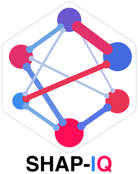
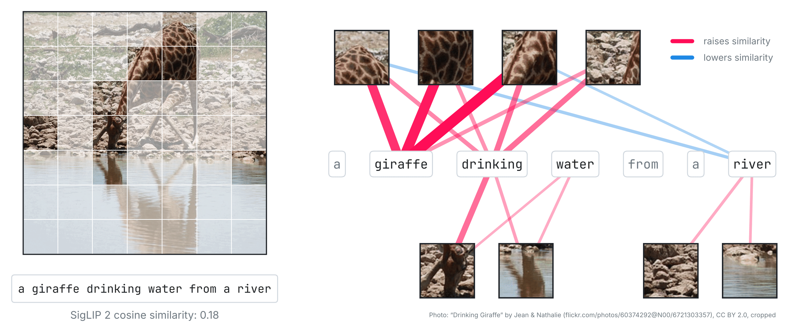
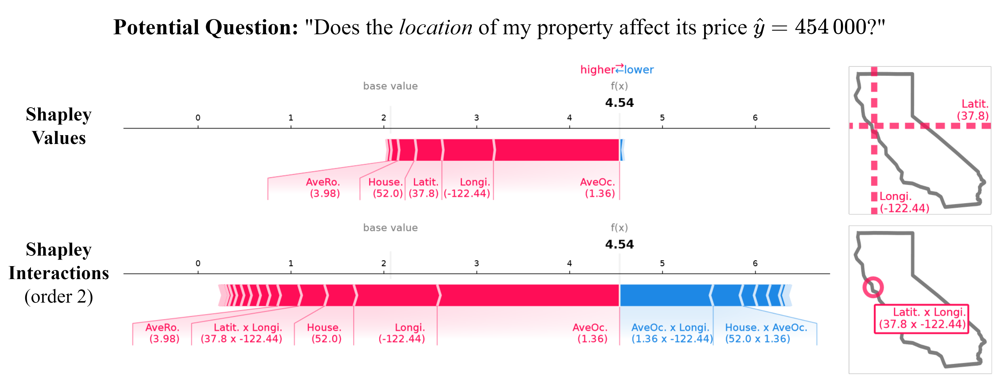

:hide-toc:

Shapley Interactions for Machine Learning
=========================================

.. container:: shapiq-hero

   .. container:: shapiq-star-note

      psst… enjoying shapiq? Help us out and `⭐ star us on GitHub!
      <https://github.com/mmschlk/shapiq>`__

   .. container:: shapiq-hero-lead

      ``shapiq`` explains machine learning models with **Shapley values** and **Shapley
      interactions**. Shapley values split a prediction fairly among the features; Shapley
      interactions also credit the groups of features that act together, such as latitude and
      longitude that only together locate a house.

   Exact algorithms for tree ensembles, nearest neighbors, and kernel methods, more than twenty
   approximators for any model, and games and benchmarks for research on cooperative game theory
   in machine learning.

   .. container:: shapiq-hero-buttons

      .. button-ref:: introduction/start
         :ref-type: doc
         :color: primary
         :class: shapiq-button

         Get started

      .. button-ref:: examples
         :ref-type: doc
         :color: secondary
         :outline:
         :class: shapiq-button

         Examples

      .. button-ref:: api_reference
         :ref-type: doc
         :color: secondary
         :outline:
         :class: shapiq-button

         API reference

      .. button-link:: https://github.com/mmschlk/shapiq
         :color: secondary
         :outline:
         :class: shapiq-button

         :octicon:`mark-github` GitHub

   .. container:: shapiq-hero-meta

      Python 3.12+ · MIT license · Published at NeurIPS 2024

         river", explained by a network of image regions and words, linked by the interactions
         that raise (red) or lower (blue) the similarity that SigLIP 2 assigns them.

   Which words go with which parts of the image? ``shapiq`` explains how well SigLIP 2 matches a
   photo and its caption by the interactions of image regions and words, as in FIxLIP
   :cite:p:`Baniecki.2025`.

Install
-------

.. tab-set::
   :sync-group: installer

   .. tab-item:: pip
      :sync: pip

      .. code-block:: bash

         pip install shapiq

   .. tab-item:: uv
      :sync: uv

      .. code-block:: bash

         uv add shapiq

   .. tab-item:: Development version
      :sync: git

      .. code-block:: bash

         pip install git+https://github.com/mmschlk/shapiq

Extras such as ``shapiq[tree]`` add a faster tree backend, more approximators, and the
dependencies of the games and the benchmark: see :doc:`introduction/installation`.

Explain a Prediction
--------------------

Train a model, pick an index and an order, and explain a prediction. For a random forest,
:class:`~shapiq.explainer.Explainer` computes the values exactly with the
:class:`~shapiq.explainer.TreeExplainer`.

.. code-block:: python

   from sklearn.datasets import fetch_california_housing
   from sklearn.ensemble import RandomForestRegressor

   import shapiq

   X, y = fetch_california_housing(return_X_y=True)
   model = RandomForestRegressor(n_estimators=50, max_depth=10, random_state=0).fit(X, y)

   # pairwise Shapley interactions (k-SII up to order 2) of the first house
   explainer = shapiq.Explainer(model, data=X, index="k-SII", max_order=2)
   interaction_values = explainer.explain(X[0])
   print(interaction_values)
   interaction_values.plot_force()

.. code-block:: text
   :class: shapiq-output

   InteractionValues(
       index=k-SII, max_order=2, min_order=0, estimated=False, estimation_budget=None,
       n_players=8, baseline_value=2.0674158944573646,
       Top 10 interactions:
           (0,): 2.266025054354417
           (): 2.0674158944573646
           (7,): 0.2783641039520189
           (0, 1): 0.2572118576963052
           (1,): 0.13368765294448415
           (1, 7): -0.06216726789294137
           (1, 6): -0.06654762058114373
           (6,): -0.0890745350881206
           (0, 6): -0.1877658520839556
           (0, 7): -0.20161040935064278
   )

The tuples are the players (features): ``(0,)`` is the effect of the median income alone,
``(0, 1)`` the interaction of the median income and the house age. The :doc:`introduction/start`
explains any model, plots the values, and computes values of games.

Why Shapley Interactions?
-------------------------

A Shapley value is one number per feature that mixes the feature's own effect with its joint
effects with other features. Shapley interactions separate them. For a house in San Francisco,
the Shapley values credit latitude and longitude separately; the interactions of order 2 show
that latitude matters only together with longitude, as the location of the house.

         California house: the interactions credit latitude and longitude jointly.

   The predicted price of a house explained with Shapley values (top) and with Shapley
   interactions of order 2 (bottom). Read more in :doc:`introduction/index`.

What's Inside
-------------

Three packages, installed together:

.. grid:: 1 1 3 3
   :gutter: 3
   :class-container: shapiq-cards

   .. grid-item-card:: :octicon:`package` shapiq
      :link: api_reference
      :link-type: doc
      :class-card: shapiq-card

      Explainers for any model, exact algorithms for trees, nearest neighbors, and kernel
      methods, approximators, imputers, and plots.

   .. grid-item-card:: :octicon:`apps` shapiq_games
      :link: api_reference_games
      :link-type: doc
      :class-card: shapiq-card

      Cooperative games to explain, value, and select: synthetic games with known values,
      model-specific games, and machine learning games.

   .. grid-item-card:: :octicon:`trophy` shapiq_benchmark
      :link: api_reference_benchmark
      :link-type: doc
      :class-card: shapiq-card

      Benchmarks with exact ground truth: games built from datasets and models, error and
      ranking metrics, and a runner for approximators.

Explore the Examples
--------------------

.. grid:: 1 2 3 3
   :gutter: 3
   :class-container: shapiq-cards

   .. grid-item-card:: :octicon:`rocket` Getting Started
      :link: auto_examples/basics/index
      :link-type: doc
      :class-card: shapiq-card

      Shapley values and interactions of a scikit-learn model, and your own games.

   .. grid-item-card:: :octicon:`check-circle` Exact Computation
      :link: auto_examples/exact_computation/index
      :link-type: doc
      :class-card: shapiq-card

      Every index of a small game exactly, with the Möbius transform and the core.

   .. grid-item-card:: :octicon:`zap` Approximators
      :link: auto_examples/approximators/index
      :link-type: doc
      :class-card: shapiq-card

      Shapley values and interactions of large games within a budget of evaluations.

   .. grid-item-card:: :octicon:`workflow` Tree Ensembles
      :link: auto_examples/trees/index
      :link-type: doc
      :class-card: shapiq-card

      Exact values and interactions of scikit-learn, XGBoost, LightGBM, and CatBoost trees.

   .. grid-item-card:: :octicon:`people` Nearest Neighbors
      :link: auto_examples/nearest_neighbors/index
      :link-type: doc
      :class-card: shapiq-card

      Exact data valuation and explanations of nearest-neighbor models.

   .. grid-item-card:: :octicon:`graph` Kernel Methods
      :link: auto_examples/kernel_methods/index
      :link-type: doc
      :class-card: shapiq-card

      Exact Shapley values of Gaussian processes and other product-kernel models.

   .. grid-item-card:: :octicon:`eye` Visualization
      :link: auto_examples/visualization/index
      :link-type: doc
      :class-card: shapiq-card

      Force, waterfall, bar, beeswarm, scatter, network, SI graph, and UpSet plots.

   .. grid-item-card:: :octicon:`telescope` Applications
      :link: auto_examples/applications/index
      :link-type: doc
      :class-card: shapiq-card

      TabPFN, language models, and causal effects.

   .. grid-item-card:: :octicon:`trophy` Games and Benchmarks
      :link: auto_examples/benchmarking/index
      :link-type: doc
      :class-card: shapiq-card

      The games of ``shapiq_games`` and benchmarks of approximators.

More details, such as imputers and parallel computation, are in
:doc:`auto_examples/technicalities/index`; all groups are listed in :doc:`examples`.

Learn More
----------

.. grid:: 1 1 3 3
   :gutter: 3
   :class-container: shapiq-cards

   .. grid-item-card:: :octicon:`light-bulb` Shapley Interactions
      :link: introduction/index
      :link-type: doc
      :class-card: shapiq-card

      What Shapley interactions are, and when they tell more than Shapley values.

   .. grid-item-card:: :octicon:`history` Timeline
      :link: timeline
      :link-type: doc
      :class-card: shapiq-card

      Shapley-based methods for machine learning, from the Shapley value to today.

   .. grid-item-card:: :octicon:`book` Bibliography
      :link: references
      :link-type: doc
      :class-card: shapiq-card

      The papers behind the methods of ``shapiq``, and related software.

Cite shapiq
-----------

If you enjoy using ``shapiq``, please consider citing our NeurIPS paper :cite:p:`Muschalik.2024`.

.. dropdown:: BibTeX
   :icon: quote
   :class-container: shapiq-cite

   .. code-block:: bibtex

      @inproceedings{muschalik2024shapiq,
        title     = {shapiq: Shapley Interactions for Machine Learning},
        author    = {Maximilian Muschalik and Hubert Baniecki and Fabian Fumagalli and
                     Patrick Kolpaczki and Barbara Hammer and Eyke H\"{u}llermeier},
        booktitle = {The Thirty-eight Conference on Neural Information Processing Systems Datasets and Benchmarks Track},
        year      = {2024},
        url       = {https://openreview.net/forum?id=knxGmi6SJi}
      }

.. toctree::
   :hidden:
   :maxdepth: 1
   :caption: Getting Started

   introduction/installation
   introduction/start
   introduction/index
   introduction/why-use-shapiq

.. toctree::
   :hidden:
   :maxdepth: 2
   :caption: User Guide

   examples
   timeline

.. toctree::
   :hidden:
   :maxdepth: 2
   :caption: API Reference

   api_reference
   api_reference_games
   api_reference_benchmark

.. toctree::
   :hidden:
   :maxdepth: 1
   :caption: Bibliography

   related_software
   references
